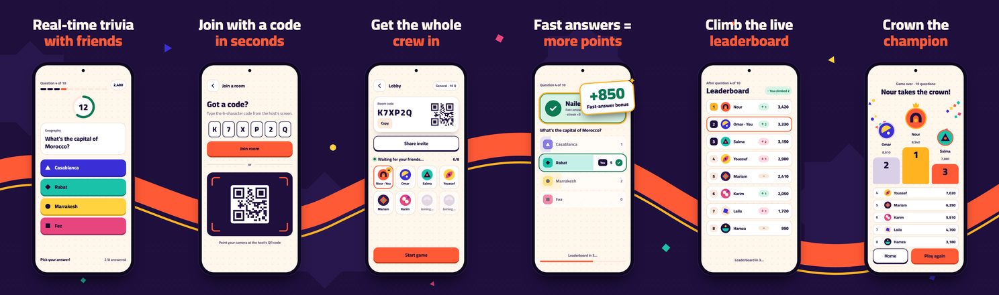
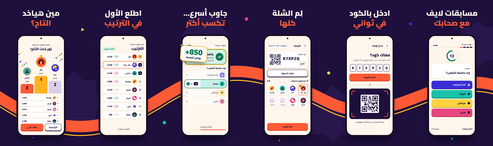
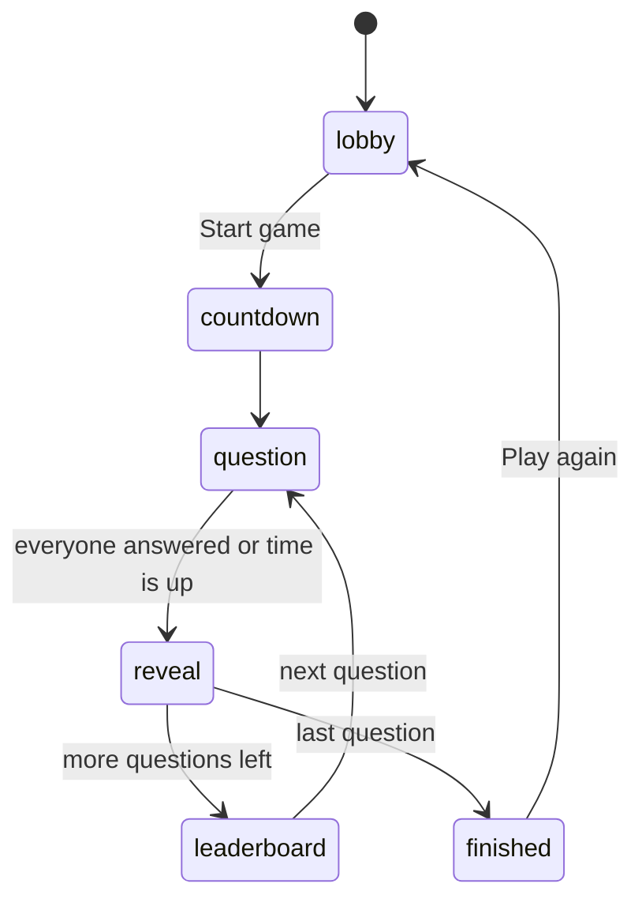

# Yalla Quiz (يلا كويز)

Real-time multiplayer trivia for friends, in English and Arabic.

One player creates a room, everyone else joins with a 6-character code or a QR scan, and the whole group answers the same question against the same clock. The app is fully bilingual with right-to-left Arabic, and each player sees their own language in the same room. It runs on Android, iOS and the web. On a tablet, laptop or TV, the host can run the game in big-screen mode while the players answer on their phones.

## Screenshots





## Features

- **Rooms with codes and QR.** Share a 6-character code, an invite link, or a QR code that other phones scan to join.
- **Live presence and host takeover.** Players who drop show as reconnecting and keep their score. If the host leaves, the next player takes over and the game carries on from the current phase.
- **Server-synced timer.** Every device times the question from the same server timestamp, so the clock agrees everywhere.
- **Scoring with a speed bonus.** A correct answer scores 500 points plus up to 500 more for speed. Streaks are tracked as a badge.
- **Reveal, leaderboard and podium.** Vote counts per option, the points you just won, rank changes, and a podium with confetti at the end.
- **Big-screen host.** The host can choose to run the room on a large screen as a spectator, with layouts made for a TV or laptop.
- **6 categories, 280 questions.** General, Geography, Food, Movies & TV, Music and Football, each question written in both languages.
- **Sounds and Arabic voice lines.** A spoken "3, 2, 1, Yalla!" countdown and cheers, with separate Sound effects and Voice settings.
- **Light and dark themes**, following the system or chosen in Settings.
- **Accessibility.** WCAG contrast ratios pinned by tests, reduced motion respected throughout, and screen-reader labels on interactive elements.

## Tech stack

Versions are the constraints in `pubspec.yaml`.

| Area | Packages |
|---|---|
| Framework | Flutter (Dart SDK `^3.13.5`) |
| State | `flutter_bloc ^9.1.1` (Cubits) |
| Dependency injection | `get_it ^9.3.0` |
| Routing | `go_router ^18.1.0` |
| Models | `freezed ^4.0.3`, `json_serializable ^6.14.1` |
| Errors | `fpdart ^1.2.0` (`Either<Failure, T>`) |
| Localization | `easy_localization ^3.0.8` (English and Arabic) |
| Backend | `firebase_core ^5.0.0`, `firebase_auth ^7.0.0` (Anonymous Auth), `firebase_database ^13.0.0` (Realtime Database) |
| Layout | `flutter_screenutil ^5.9.3` |
| QR and sharing | `pretty_qr_code ^3.6.0`, `mobile_scanner ^7.4.2`, `share_plus ^13.3.1` |
| Media | `flutter_svg ^2.3.0`, `audioplayers ^6.8.1` |
| Device | `wakelock_plus ^1.8.1`, `shared_preferences ^2.5.6` |
| Code generation | `build_runner ^2.16.2`, `flutter_gen_runner ^5.15.0` |

## Architecture

The code follows a feature-first clean architecture. Each feature has `data/` (data sources, DTOs, repository implementations), `domain/` (entities, repository interfaces, services) and `presentation/` (cubits, pages, widgets). Presentation never talks to Firebase directly.

```
lib/
├── main.dart, app.dart
├── core/          di, router, theme, constants, services, utils, widgets, network
├── features/
│   ├── home/      ├── lobby/     ├── room/      ├── settings/
│   ├── game/      ├── profile/   └── results/
└── gen/           generated asset paths (flutter_gen)
```

### How the game loop works

There are no Cloud Functions, so the host's device runs the game:

- **The engine is pure.** `GameEngine` takes the room as it is in the database and returns the next command and when it's due. It has no timers and no Flutter dependencies.
- **One driver.** `GameHostDriver` runs the engine on the host and re-reads the latest room whenever a timer fires. A new host therefore resumes from whatever phase the database is in.
- **Server time.** Every phase stores a server timestamp, and every device adds its server-time offset. Clients never count down locally.
- **One write per step.** Each command is a single multi-path update.
- **The security rules are the referee.** They allow only legal phase changes. They accept one answer per player, before the deadline. They allow a question to be scored only once: scores must equal the old score plus the new points, in the same write that marks the question scored.



The schema, the full rules and the project conventions are in [CLAUDE.md](CLAUDE.md).

## Getting started

### Prerequisites

- Flutter on the stable channel, with Dart `^3.13.5` (developed on Flutter 3.47.7).
- The [Firebase CLI](https://firebase.google.com/docs/cli) and the [FlutterFire CLI](https://firebase.google.com/docs/flutter/setup), to connect your own Firebase project.
- Node.js, for the security-rules tests and the end-to-end test (developed on Node 24).
- Chrome, for running on the web and for the end-to-end test.

### Install

```sh
git clone <this repository>
cd yalla_quiz
flutter pub get
dart run build_runner build --delete-conflicting-outputs
```

The generated files are committed. Run `build_runner` again after changing a freezed or json model, or after adding assets.

### Connect your Firebase project

The repo is wired to the author's Firebase project, so point it at your own:

1. Create a project in the [Firebase console](https://console.firebase.google.com/).
2. Enable **Authentication → Sign-in method → Anonymous**.
3. Create a **Realtime Database**, in any region.
4. Generate the app config. This rewrites `lib/firebase_options.dart` and the platform config files:

   ```sh
   firebase login
   firebase use --add            # pick your project; updates .firebaserc
   flutterfire configure         # pick your project and the platforms
   ```

5. In `lib/core/constants/app_constants.dart`, set `kDatabaseUrl` to your database URL, from the Realtime Database page in the console. FlutterFire doesn't write the URL to `firebase_options.dart`. Also point `kInviteBaseUrl`, the link in invites and the lobby QR code, at your own web domain.
6. Deploy the security rules:

   ```sh
   firebase deploy --only database
   ```

### Run

```sh
flutter run                   # a connected phone or emulator
flutter run -d chrome         # the web
```

### Run against the local emulators

The emulator ports are set in `firebase.json`: auth on 9099 and the database on 9000. The emulators load `database.rules.json`.

```sh
firebase emulators:start --only auth,database
flutter run --dart-define=YQ_EMULATOR=true
```

On a physical device, also pass your computer's LAN address:

```sh
flutter run --dart-define=YQ_EMULATOR=true --dart-define=YQ_EMULATOR_HOST=192.168.1.20
```

## Testing

```sh
flutter analyze
flutter test
```

- **`flutter analyze`**: lints with `flutter_lints` and the rules in `analysis_options.yaml`.
- **`flutter test`**: about 500 tests:
  - unit tests for scoring, the game engine and question picking;
  - whole simulated games on a fake clock and a fake server that mirrors the rules;
  - every screen and state rendered in light and dark, English and Arabic, at phone, tablet and desktop sizes, failing on any overflow or build error;
  - contrast ratios and the question files.

**Security rules.** These check every rule in `database.rules.json` against the database emulator:

```sh
cd test/rules
npm install
npm test
```

**End to end.** This builds the web app, plays a full 5-question game in the emulators with three Chrome sessions, and checks every score in the database. The sessions are a big-screen host, an English player and an Arabic player. The game includes a timeout, a host drop with takeover, and Play again. Details are in [test/e2e/README.md](test/e2e/README.md).

```sh
cd test/e2e
npm install
npm run build
npm test
```

## Content

Questions live in `assets/questions/<category>.json`. Each file is a list of entries:

```json
{
  "id": "geography_014",
  "en": { "q": "What's the capital of Oman?", "options": ["Salalah", "Muscat", "Sohar", "Nizwa"] },
  "ar": { "q": "إيه عاصمة عُمان؟", "options": ["صلالة", "مسقط", "صحار", "نزوى"] },
  "answer": 1
}
```

`answer` is the index of the correct option, and it's the same in both languages. Categories come from the files themselves: the app lists every JSON file in `assets/questions/`.

Each category except General has a review table in `design/content/<category>_review.md`. It lists every question with its difficulty, region, correct answer and a confidence rating, with anything uncertain listed first. The questions follow these rules:

- **Stable facts only.** Nothing that changes over time, such as records, current squads or "most" counts. Movies, music and football stop at 2023.
- **Exact wording.** Questions are hedged ("mainly", "traditionally", "usually") wherever a plain statement wouldn't be exactly true.
- **No giveaways.** The Arabic wording and options don't reveal the answer, and wrong options are plausible.
- **Balance.** About 40% Egyptian and Arab content, and the correct answer spread evenly across the four positions.

### Editing questions and adding a category

The generated categories have a source file in `tool/content/`. Edit a question there, then rebuild the JSON and the review table with `python3 tool/content/build.py <category>`. See [tool/content/README.md](tool/content/README.md).

To add a category:

1. Add `assets/questions/<id>.json` with ids `<id>_001`, `<id>_002`, … The easiest way is a new source file in `tool/content/`, built with `build.py`.
2. Add the name under `categories.<id>` in `assets/translations/en.json` and `ar.json`.
3. Optionally, give it a colour and shape in `lib/features/room/presentation/widgets/category_style.dart`. Otherwise it uses the default style.
4. Run `flutter test`. `test/features/game/questions_asset_test.dart` checks the ids, that both languages have text and 4 distinct options, that the answer index is valid, and that no question repeats across categories.

## Sounds and voice

Sound effects go in `assets/sounds/`, and any missing file is skipped:

`countdown_tick.mp3`, `yalla.mp3`, `lock_in.mp3`, `timer_tick.mp3`, `time_up.mp3`, `correct.mp3`, `wrong.mp3`, `leaderboard.mp3`, `victory.mp3`

Voice lines go in `assets/sounds/voice/` and are named per language:

```
voice_<name>_<lang>.mp3          one take, e.g. voice_time_up_ar.mp3
voice_<name>_<lang>_<n>.mp3      several takes, picked at random, e.g. voice_correct_ar_1.mp3
```

- **Names:** `count_3`, `count_2`, `count_1`, `yalla`, `correct`, `wrong`, `time_up`, `leaderboard`, `victory`.
- **Language:** each device plays its own app language, and a language without a file stays silent.
- **Countdown:** the spoken digits replace the tick sounds.

To make the four countdown clips, record "3, 2, 1, Yalla!" in one take with short pauses between the phrases, then split it:

```sh
python3 tool/split_countdown.py design/sounds/voice_countdown_ar.mp3 ar
```

The script needs `ffmpeg`. Source recordings are kept in `design/sounds/`.

## Design

- **`design/app/`**: the designer's handoff.
  - `screens.md` is the per-screen spec.
  - `screens/` holds the phone and tablet mockups in both languages.
  - `design-tokens.json` lists the tokens.
- **`design/brand/`**: the wordmark, hero and countdown artwork, with usage notes. The app uses the SVGs in `assets/images/`.
- **`design/icon/`**: the app icon sources.
- **`design/store/`**: store graphics and the screenshots above.

The theme files in `lib/core/theme/` (`yq_colors.dart`, `yq_typography.dart`, `yq_spacing.dart`, `yq_theme.dart`) come from the designer and aren't edited by hand. Widgets read colours, type, spacing and motion from them instead of hard-coding values.

## Known limitations and roadmap

**Limitations:**
- **No Cloud Functions.** The app is on Firebase's free Spark plan, so the host's device runs the game loop and the security rules enforce fair play. Rooms everyone abandoned are only cleaned up when their code is reused after 2 hours.
- **The host must stay in the foreground.** The game advances from the host's device. If the host leaves the app, the room waits 10 seconds for them to come back, then hands over to another player.
- **Answers are readable during a question.** A technical player could read other players' picks from the database. The answer key also ships inside the app. This is acceptable for a casual game, and the fix is server-side answers with Cloud Functions.
- **No iOS swipe-back.** In-flow pages don't support the iOS swipe-back gesture yet.

**Planned:**
- Firebase Hosting for the web app and invite links
- A privacy policy
- Firebase App Check
- A Play Store release

## License

License: TBD.
